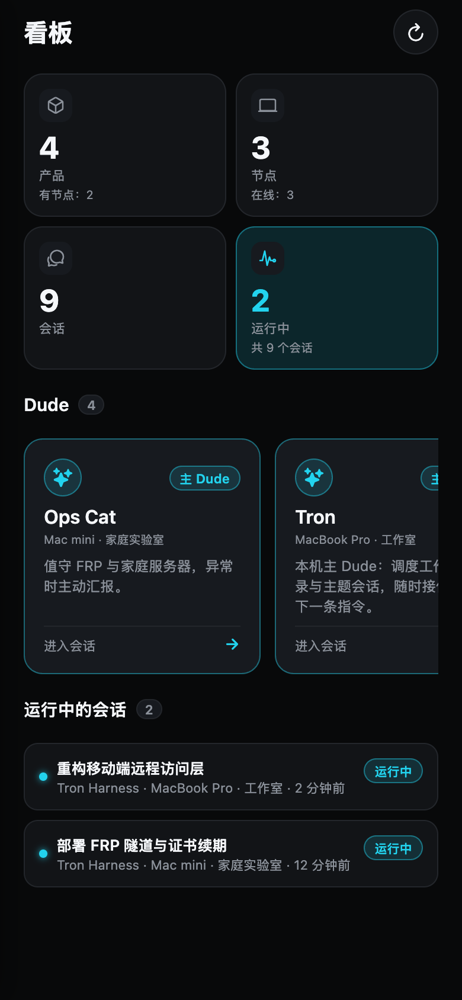
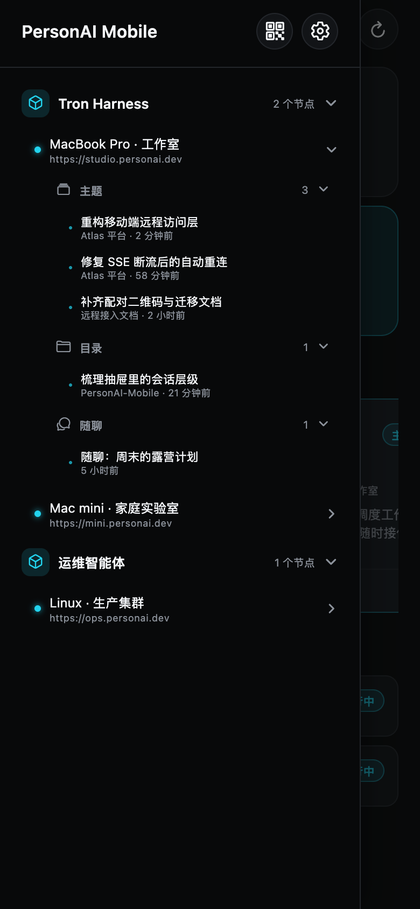
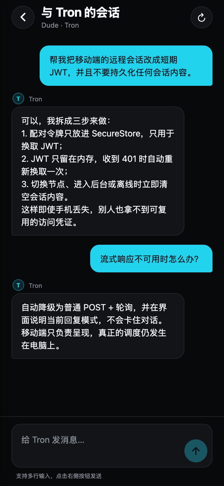
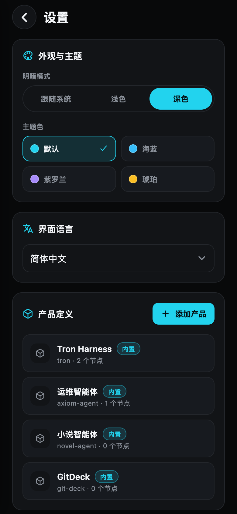
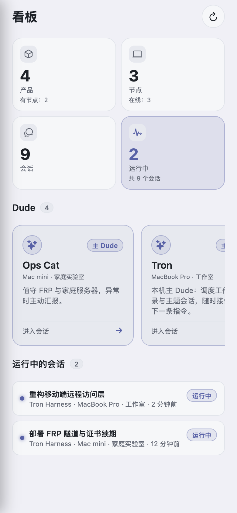

# PersonAI Mobile

**Your desktop AI workspace, in your pocket.**

<p align="center">
  <a href="README.md">简体中文</a> · <b>English</b> · <a href="README.ja.md">日本語</a>
</p>

<p align="center">
  <a href="LICENSE"></a>
  
  <a href="https://expo.dev"></a>
  <a href="https://reactnative.dev"></a>
  <a href="https://github.com/Penglai-Link/PersonAI-Mobile/pulls"></a>
</p>

PersonAI Mobile is the open-source mobile client for the Person-AI ecosystem. It connects the AI products running on your computer or home server: one dashboard for the big picture, one message to continue a conversation, one tap for the approval that matters.

Execution, files, and tools stay on the computer. The phone is where you start work, check progress, and keep talking.

<p align="center">
  
  
  
</p>
<p align="center"><sub>Cross-node dashboard · products, nodes and sessions · conversation with a PersonAI (Chinese UI, demo data)</sub></p>

## One dashboard for every node

The home screen summarizes every product and node: product count, online nodes, sessions, running tasks, and PersonAI cards from different machines.

You do not have to pick a computer first, and one offline machine never hides the others. A node is only contacted when you open a session; the dashboard itself does not interrupt the conversation you are in.

## Swipe from the left edge to open your sessions

On any screen, swipe right from the left edge to open the drawer. It is organized by product, node, workspace, and session group:

```text
Product
└── Node
    └── Workspace
        └── Session group
            └── Session subgroup
                └── Session
```

- The first level comes from the product's navigation widgets (for Tron: topics, directories, quick chats); the product owns the labels and order.
- The second level also comes from product data: project name for topics, directory name for directories; quick chats list sessions directly. Products without these groupings fall back to a flat session list.
- Multiple computers under the same product are listed together.
- Sessions load on demand and live only in memory; they are cleared when you switch nodes or go offline.

## Replies appear as they are written

Chat uses streaming, so a reply appears while it is still being generated. The composer supports multiple lines, and send, retry, and offline states all have clear feedback.

The UI is built with native components, so long lists and the keyboard feel closer to a system app.

## Works at home and away

- **At home**: the app automatically uses the local network, which is the fastest path.
- **Away**: connect through an HTTPS entry point you host yourself. Your computer does not need a public IP, and you never switch nodes by hand.
- **Switching**: the app re-evaluates available addresses when the network changes and only marks a node offline after every candidate fails.
- **Privacy**: the public path uses TLS, with an additional application-layer encryption inside it. Chat history stays in phone memory only.

See [Self-hosted public tunnel](docs/self-hosted-tunnel.en.md) for FRP, Cloudflare Tunnel, Tailscale, and reverse-proxy setup. See [Remote access internals](docs/remote-access.en.md) for the protocol and implementation.

## Security and privacy

| Data | Stored in | Retained until |
| --- | --- | --- |
| Device key | Phone secure storage, one per computer | The node is removed or re-paired |
| Sessions and messages | Memory only | The app exits |
| Products, nodes, UI preferences | Local phone storage | Indefinitely |

- If the phone is lost, the computer can revoke that device remotely.
- The public entry point is controlled by you; traffic does not pass through a Person-AI relay service.
- Switching nodes, going to the background, or going offline clears in-memory conversation content.

## Designed for the phone

Four accent colors, light/dark/system themes, and a UI available in Simplified Chinese, English, and Japanese. Themes belong to the phone and never follow a computer's skin. Language changes apply immediately and are saved locally.

<p align="center">
  
  
</p>
<p align="center"><sub>Theme, language and product definitions · light mode (Chinese UI, demo data)</sub></p>

## Multiple products, plus your own

Built-in products work out of the box, and you can add your own product codes in Settings. Pair a node by scanning a QR code or pasting a pairing link.

| Product | Code | Mobile capabilities |
| --- | --- | --- |
| Tron Harness | `tron` | Topic/directory/quick-chat groups, PersonAI, workspaces, streaming sessions |
| Axiom Agent | `axiom-agent` | Sessions, workspaces, PersonAI summaries |
| Novel Agent | `novel-agent` | Sessions, workspaces, PersonAI summaries |
| GitDeck | `git-deck` | Sessions, workspaces, PersonAI summaries |
| Custom product | lowercase letters, digits, `.` or `-` | Single-level session list, addable and removable |

## Getting started

The project is still in early preview; installers and store distribution are still being finalized.

1. Start the Person-AI service on your computer and enable remote access.
2. Install PersonAI Mobile. Only development builds are available right now.
3. Open the scan entry in the top-right corner of the drawer and scan the QR code on the computer, or paste the pairing link manually.

At home on the same Wi-Fi, the app connects directly. Away from home, it switches to your public entry point automatically when one is configured.

## Known limitations

- Early preview: device testing and store distribution are not finished.
- Messages are plain text; Markdown and attachments are not rendered yet.
- Public access requires you to configure a tunnel; no relay service is provided by default.
- The web preview is for debugging only, not for production use.

## Documentation

- [Remote access internals](docs/remote-access.en.md): protocol, encryption, RPC, and endpoint selection.
- [Self-hosted public tunnel](docs/self-hosted-tunnel.en.md): FRP, Cloudflare Tunnel, Tailscale, Caddy/Nginx.
- [Development](DEVELOPMENT.en.md) · [AGENTS.md](AGENTS.md)

## Contributing

Issues and pull requests are welcome. For changes involving networking, session persistence, or navigation gestures, explain the security boundary and how you verified it.

If this project is useful to you, a Star is appreciated.

## License

[GNU Affero General Public License v3.0](LICENSE) © Person-AI

PersonAI Mobile is free software: you may use, modify, and redistribute it. If you provide it as a network service, you must publish the corresponding source under AGPL.

---

[Development](DEVELOPMENT.en.md) · [简体中文](README.md) · [日本語](README.ja.md) · [AGPL-3.0](LICENSE)
