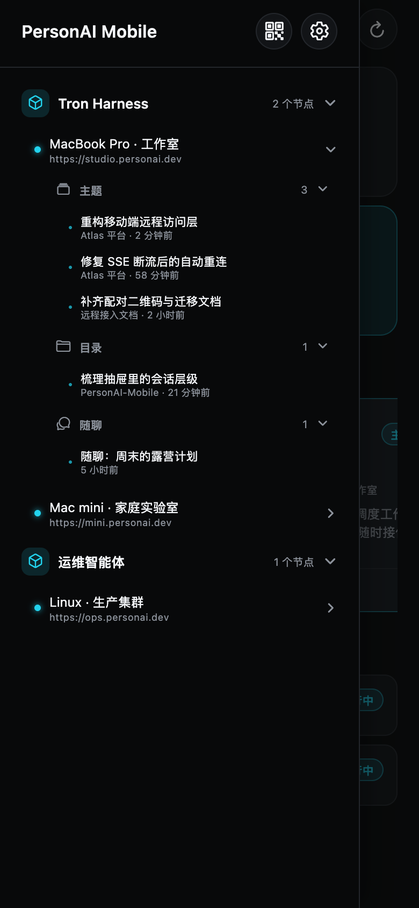
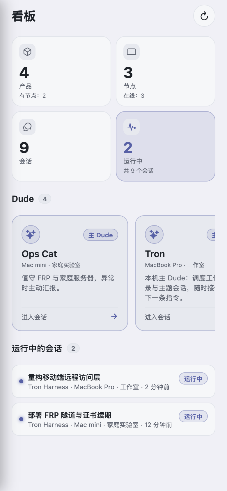

# PersonAI Mobile

**デスクトップの AI ワークスペースを、ポケットに。**

<p align="center">
  <a href="README.md">简体中文</a> · <a href="README.en.md">English</a> · <b>日本語</b>
</p>

<p align="center">
  <a href="LICENSE"></a>
  
  <a href="https://expo.dev"></a>
  <a href="https://reactnative.dev"></a>
  <a href="https://github.com/Penglai-Link/PersonAI-Mobile/pulls"></a>
</p>

PersonAI Mobile は Person-AI エコシステムのオープンソース・モバイルクライアントです。PC や自宅サーバーで動く AI プロダクトをつなぎます。ダッシュボードで全体を見渡し、メッセージで会話を続け、必要な承認をその場でタップできます。

実行、ファイル、ツールは PC 側に残ります。スマートフォンは、依頼を出し、進捗を見て、会話を続けるための端末です。

<p align="center">
  
  
  
</p>
<p align="center"><sub>ノード横断ダッシュボード · プロダクト、ノード、セッション · PersonAI との会話（中国語 UI、デモデータ）</sub></p>

## すべてのノードを一つのダッシュボードで

ホーム画面には、すべてのプロダクトとノードの概要が表示されます。プロダクト数、オンラインのノード、セッション数、実行中のタスク、そして各ノードの PersonAI カードです。

先に PC を選ぶ必要はなく、1 台がオフラインでも他のマシンの情報は隠れません。セッションを開いたときだけ該当ノードへ接続するため、ダッシュボードが会話を中断することはありません。

## 左端からスワイプしてセッションを開く

どの画面でも、画面左端から右へスワイプするとドロワーが開きます。プロダクト、ノード、ワークスペース、セッショングループで構成されます。

```text
プロダクト
└── ノード
    └── ワークスペース
        └── セッショングループ
            └── セッションサブグループ
                └── セッション
```

- 第 1 階層はプロダクトが返すナビゲーションウィジェットです（Tron はトピック、ディレクトリ、クイックチャット）。名称と順序はプロダクト側が決めます。
- 第 2 階層もプロダクトのデータです。トピックはプロジェクト名、ディレクトリはディレクトリ名、クイックチャットはセッションを直接並べます。グループがないプロダクトは単一階層になります。
- 同じプロダクトの複数 PC はまとめて表示されます。
- セッションは必要なときだけ読み込まれ、メモリだけに保持されます。ノード切替やオフライン時に消去されます。

## 返答は生成しながら表示される

チャットはストリーミングで、返答は生成の途中から表示されます。入力欄は複数行に対応し、送信、再試行、オフライン状態も明確にフィードバックされます。

UI はネイティブコンポーネントで実装されているため、長いリストのスクロールやキーボード表示がシステムアプリに近い操作感になります。

## 自宅でも外出先でもつながる

- **自宅**: アプリは自動的に LAN を使います。最も速い経路です。
- **外出先**: 自分で用意した HTTPS 入口から接続します。PC にグローバル IP は不要で、ノードを手動で切り替える必要もありません。
- **切替**: ネットワークが変わると利用可能なアドレスを再評価し、すべて失敗したときだけオフラインにします。
- **プライバシー**: インターネット経路は TLS を使い、その内側にアプリケーション層の暗号化があります。会話履歴はスマートフォンのメモリだけに保存されます。

FRP、Cloudflare Tunnel、Tailscale、リバースプロキシの設定は
[自前のインターネットトンネル](docs/self-hosted-tunnel.ja.md) を、プロトコルと実装の詳細は
[リモートアクセス技術資料](docs/remote-access.ja.md) を参照してください。

## セキュリティとプライバシー

| データ | 保存場所 | 保持期間 |
| --- | --- | --- |
| デバイス鍵 | スマートフォンのセキュアストレージ（PC ごと） | ノード削除または再ペアリングまで |
| セッションとメッセージ | メモリのみ | アプリ終了まで |
| プロダクト、ノード、UI 設定 | 端末のローカルストレージ | 永続 |

- スマートフォンを紛失しても、PC 側から該当デバイスをリモート失効できます。
- インターネット入口は自分で管理します。Person-AI の中継サービスは経由しません。
- ノード切替、バックグラウンド移行、オフライン時にメモリ上の会話内容は消去されます。

## スマートフォンのための UI

4 種類のアクセントカラー、ライト／ダーク／システム連動テーマ、简体中文・English・日本語の UI。テーマはスマートフォン側のもので、PC のスキンには追従しません。言語変更は即時反映され、端末に保存されます。

<p align="center">
  
  
</p>
<p align="center"><sub>テーマ、言語、プロダクト定義 · ライトモード（中国語 UI、デモデータ）</sub></p>

## 複数プロダクトと独自プロダクト

組み込みプロダクトはすぐに使え、設定から独自のプロダクトコードも追加できます。ノードは QR コードのスキャンまたはペアリングリンクの貼り付けでペアリングします。

| プロダクト | コード | スマートフォンでの機能 |
| --- | --- | --- |
| Tron Harness | `tron` | トピック／ディレクトリ／クイックチャット、PersonAI、ワークスペース、ストリーミングセッション |
| Axiom Agent | `axiom-agent` | セッション、ワークスペース、PersonAI 概要 |
| Novel Agent | `novel-agent` | セッション、ワークスペース、PersonAI 概要 |
| GitDeck | `git-deck` | セッション、ワークスペース、PersonAI 概要 |
| 独自プロダクト | 小文字英数字、`.`、`-` | 単一階層のセッション一覧、追加・削除可 |

## はじめかた

初期プレビュー段階のため、インストーラーとストア配布は準備中です。

1. PC で Person-AI サービスを起動し、リモートアクセスを有効にします。
2. PersonAI Mobile をインストールします。現在は開発ビルドのみです。
3. ドロワー右上のスキャン入口から PC の QR コードを読み取るか、ペアリングリンクを手動で貼り付けます。

自宅の同じ Wi-Fi では自動的に直接接続します。外出先では、インターネット入口が設定されていれば自動的に切り替わります。

## 既知の制限

- 初期プレビュー段階で、実機検証とストア配布は未完了です。
- メッセージはプレーンテキスト表示で、Markdown と添付ファイルは未対応です。
- インターネット経由のアクセスには自分でトンネルを用意する必要があります。中継サービスは標準提供しません。
- Web プレビューはデバッグ用で、本番利用向けではありません。

## ドキュメント

- [リモートアクセス技術資料](docs/remote-access.ja.md)：プロトコル、暗号化、RPC、経路選択。
- [自前のインターネットトンネル](docs/self-hosted-tunnel.ja.md)：FRP、Cloudflare Tunnel、Tailscale、Caddy/Nginx。
- [開発ドキュメント](DEVELOPMENT.ja.md) · [AGENTS.md](AGENTS.md)

## コントリビューション

Issue と Pull Request を歓迎します。ネットワーク、セッション保存、ナビゲーションジェスチャーに関わる変更は、セキュリティ境界と検証方法を PR に記載してください。

このプロジェクトが役に立ったら、Star をいただけると嬉しいです。

## ライセンス

[GNU Affero General Public License v3.0](LICENSE) © Person-AI

PersonAI Mobile は自由ソフトウェアです。使用、変更、再配布ができます。ネットワークサービスとして提供する場合は、AGPL に従って対応するソースを公開する必要があります。

---

[開発ドキュメント](DEVELOPMENT.ja.md) · [简体中文](README.md) · [English](README.en.md) · [AGPL-3.0](LICENSE)
