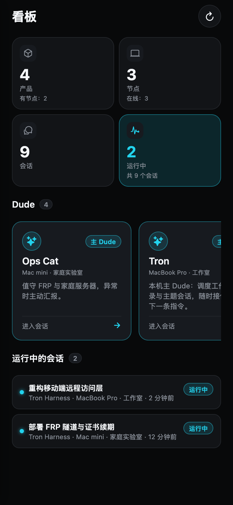
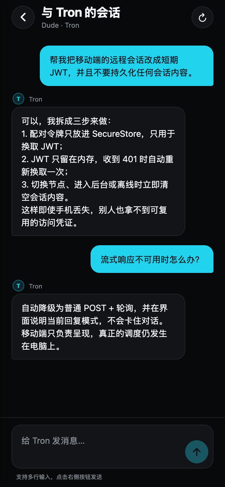
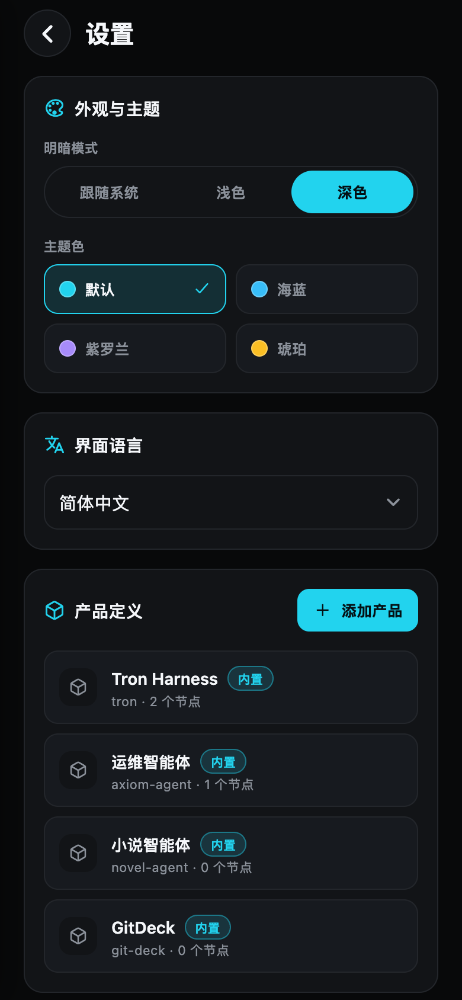

# PersonAI Mobile

**AI のワークスペースを、ポケットに。**

<p align="center">
  <a href="README.md">简体中文</a> · <a href="README.en.md">English</a> · <b>日本語</b>
</p>

<p align="center">
  <a href="LICENSE"></a>
  
  <a href="https://expo.dev"></a>
  <a href="https://reactnative.dev"></a>
  <a href="https://github.com/Penglai-Link/PersonAI-Mobile/pulls"></a>
</p>

PersonAI Mobile は Person-AI エコシステムのオープンソース・モバイルクライアントです。PC や
家庭用サーバーで動く AI サービスをつなぎ、それぞれのマシンをノードとして扱います。
ダッシュボードで全ノードの状態を確認し、画面左端からメニューを開いてプロダクトを切り替え、
前回の会話を再開できます。スマートフォンはノードに直接接続し、チャット履歴を端末に保存せず、
第三者を経由しません。

<p align="center">
  
  
  
</p>
<p align="center"><sub>ノードをまたぐダッシュボード · プロダクト、ノード、セッション · Dude との会話（中国語 UI、デモデータ）</sub></p>

## なぜ作ったのか

デスクトップは作業を実行する場所です。スマートフォンは、離れていてもつながれる場所です。
席を離れても、どのマシンでタスクが動いているのか、Dude が結果を返したのかを知りたい、
あるいはリモートノードにひとこと送りたいことがあります。そのためにノート PC を開き、VPN につなぎ、目的のウィンドウを
探すのは手間が大きすぎます。

PersonAI Mobile はデスクトップ版の縮小コピーではありません。移動中に必要な三つだけを残し
ました。全体を把握する、素早く切り替える、会話を続ける。実行、ファイル、ツール呼び出しは
PC 側に残り、スマートフォンは指示と表示を担当します。

## 主な機能

### すべてのノードを一つのダッシュボードで

ホームには、すべてのプロダクトとノードが集まります。プロダクト数、オンラインのノード、
セッション数、実行中のタスク、ノードをまたぐ Dude カード。Dude や実行中のセッションを
タップしたときにだけ、そのノードに接続してチャットを開きます。ダッシュボードは集計専用で、
データを見るために使用中のノードが切り替わることはありません。

先に PC を選ぶ必要はなく、一台がオフラインでも他のマシンの情報は隠れません。

### 左端からスワイプしてセッションを開く

どの画面でも、画面左端から右へスワイプするとサイドメニューが開きます。メニューは
プロダクト、ノード、セッションの順に整理されています。

```text
プロダクト
└── ノード
    └── セッショングループ
        └── セッション
```

- Tron Harness はセッションをトピック、ディレクトリ、チャットに分けます。その他の
  プロダクトは 1 階層のセッション一覧です。
- 同じプロダクトの複数の PC はまとめて表示され、事前に 1 台を選ぶ必要はありません。
- セッションは必要なときに読み込まれ、メモリにだけ保持されます。メニューを開き直すと
  更新され、ノードの切り替えやオフライン時に消去されます。
- QR コードの読み取りと設定は、メニュー右上に固定されています。

### 返答は生成しながら表示される

チャットはストリーミングで応答し、生成された部分から順に表示します。環境がストリームを
読み取れない場合は、通常のリクエストとポーリングに自動で切り替え、現在のモードを画面に
表示します。入力欄は複数行に対応し、送信中、再試行、オフラインの状態をそれぞれ示します。

UI はネイティブコンポーネントで構成されており、Web ページを包んだものではありません。
長いリストのスクロールやキーボードの動きも自然です。

### 安全な設定が最初から

| データ | 保存場所 | 保持期間 |
| --- | --- | --- |
| ペアリング情報 | 端末のセキュアストレージ、PC ごと | ノードを削除するか、再ペアリングするまで |
| アクセストークン | メモリのみ | 失効時、またはノード切り替え、バックグラウンド移行、オフライン時に消去 |
| セッションとメッセージ | メモリのみ | アプリ終了時に消える |
| プロダクト、ノード、画面設定 | 端末のローカルストレージ | 保持 |

- リモート接続は既定で HTTPS を必須とします。`http://` のノードは「安全でないデバッグ」を
  明示的に有効にして再確認する必要があり、それまでは一切のリクエストを送りません。
- アクセストークンが失効すると、アプリは一度だけ自動で再取得します。それでも失敗した
  場合は再ペアリングを促します。
- 端末を紛失しても、再利用できる認証情報や読めるチャット履歴は残りません。

### スマートフォンのための UI

4 種類のテーマカラーと、ライト / ダーク / システム連動の表示モード、簡体字中国語と
English の UI。
テーマはスマートフォン側に属し、PC のスキンには追従しません。言語の切り替えはすぐに反映
され、端末に保存されます。

<p align="center">
  
  
</p>
<p align="center"><sub>テーマ、言語、プロダクト定義 · ライトモード（中国語 UI、デモデータ）</sub></p>

### 組み込みプロダクトと独自プロダクト

組み込みプロダクトはすぐに使え、設定から独自のプロダクトコードも追加できます。ノードは
QR コードの読み取り、または手入力でペアリングします。アプリはノードが返すプロダクト情報を
優先し、現在のプロダクトと一致しない場合は正しいプロダクトに移動して通知します。

| プロダクト | コード | スマートフォンでの機能 |
| --- | --- | --- |
| Tron Harness | `tron` | トピック、ディレクトリ、チャット、Dude、ワークスペース、ストリーミングセッション |
| 运维智能体（運用エージェント） | `axiom-agent` | セッション、ワークスペース、Dude の集計 |
| 小说智能体（小説エージェント） | `novel-agent` | セッション、ワークスペース、Dude の集計 |
| GitDeck | `git-deck` | セッション、ワークスペース、Dude の集計 |
| 独自プロダクト | 小文字、数字、`.`、`-` | 1 階層のセッション一覧。いつでも追加・削除可能 |

組み込みプロダクトは削除できません。独自プロダクトを削除すると、その配下のノードと
ペアリング情報も削除されます。

## 向いている人

- 複数の PC や家庭用サーバーで異なる AI サービスを動かし、一つの入口で管理したい人。
- 席を離れても、タスクの状態を確認したり会話を続けたい人。
- データの境界を重視し、チャット履歴を第三者のクラウドに渡したくない人。
- Person-AI プロトコルを拡張し、独自のモバイル入口を作りたいチーム。

## はじめかた

現在はアーリープレビュー段階で、インストーラーの配布とストア公開は準備中です。試す手順は
次のとおりです。

1. PC で Person-AI サービスを起動し、リモートアクセスを有効にします。
2. スマートフォンに PersonAI Mobile をインストールします。現在は開発ビルドのみです。
3. サイドメニュー右上の QR コードの読み取りをタップし、PC に表示された QR コードを
   読み取ります。アドレスとペアリングトークンを手入力することもできます。

インストール、ビルド、ローカル開発の手順は[開発ガイド](DEVELOPMENT.ja.md)を参照してください。

## 既知の制限

- アーリープレビュー段階で、実機検証とストア配布は完了していません。
- セッションツリーは、各 PC の最初のアクティブなワークスペースだけを読み込みます。
- メッセージはプレーンテキストで表示され、Markdown と添付ファイルにはまだ対応していません。
- 「安全でないデバッグ」は個別に解除できません。ノードを削除して再ペアリングしてください。
- Web プレビューはデバッグ専用で、正式な安全利用の対象ではありません。

## コントリビューション

Issue と Pull Request を歓迎します。開始前に[開発ガイド](DEVELOPMENT.ja.md)と
[AGENTS.md](AGENTS.md) をお読みください。ネットワーク、セッションの保存、ナビゲーションの
ジェスチャーに関わる変更では、セキュリティ境界と検証方法を PR に記載してください。

このプロジェクトが役に立ったら、Star をいただけると他の人にも見つけやすくなります。

## ライセンス

[GNU Affero General Public License v3.0](LICENSE) © Person-AI

PersonAI Mobile は自由ソフトウェアです。使用、変更、配布は自由ですが、ネットワーク経由で
提供する場合は AGPL に従って対応するソースコードを公開する必要があります。

---

[開発ガイド](DEVELOPMENT.ja.md) · [简体中文](README.md) · [English](README.en.md) · [AGPL-3.0](LICENSE)