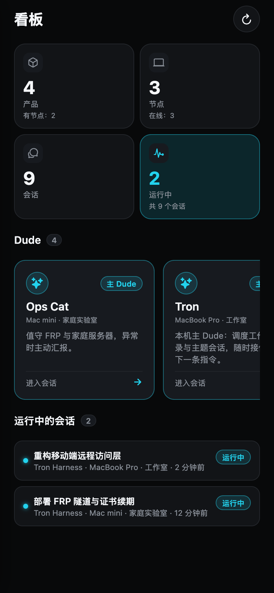
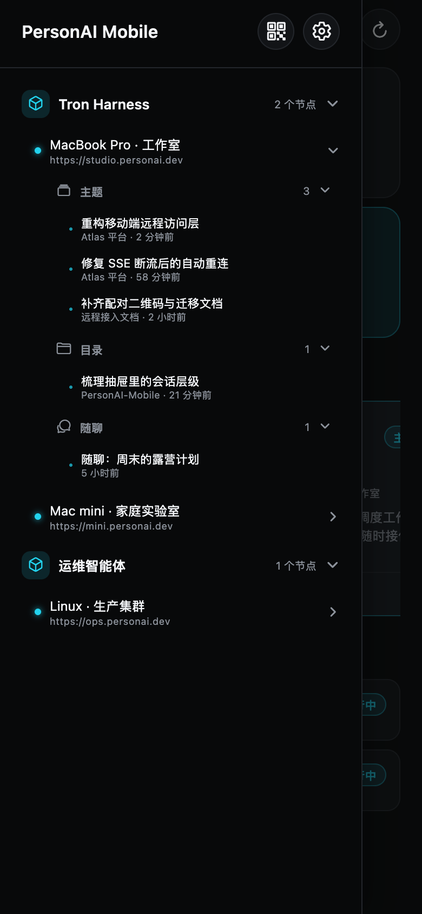
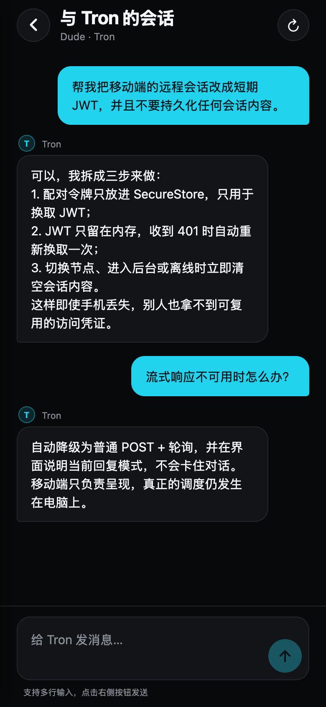
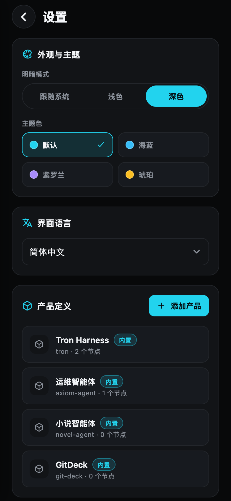
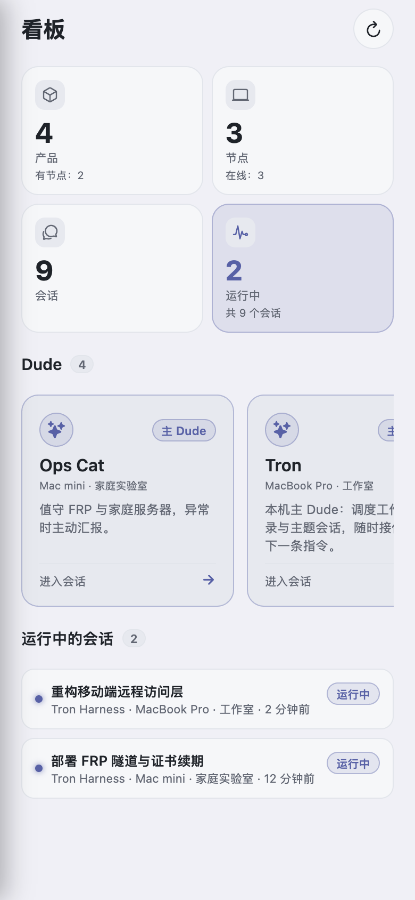

# PersonAI Mobile

**把电脑上的 AI 工作台，装进口袋。**

<p align="center">
  <b>简体中文</b> · <a href="README.en.md">English</a> · <a href="README.ja.md">日本語</a>
</p>

<p align="center">
  <a href="LICENSE"></a>
  
  <a href="https://expo.dev"></a>
  <a href="https://reactnative.dev"></a>
  <a href="https://github.com/Penglai-Link/PersonAI-Mobile/pulls"></a>
</p>

PersonAI Mobile 是 Person-AI 生态的开源移动客户端。它连接你电脑和家庭服务器上的 AI 服务，
把每台机器作为一个节点。你可以在一个看板里看到所有节点的状态，从屏幕左缘滑出菜单切换
产品，并继续之前的对话。手机会直接连接节点，聊天记录不写入手机存储，也不经过第三方中转。

> **实现说明（2026-11）**：移动端已切换到 Tron Remote Protocol：公网 WSS、局域网 WS +
> Noise IK 应用层加密，业务统一走 `session.*` / `tron.*` RPC，设备私钥存 SecureStore。
> 下文部分历史段落仍描述旧的“配对令牌 → JWT / HTTPS 闸门”模型，以
> [`AGENTS.md`](AGENTS.md) 和 [`docs/remote-access-remediation.md`](../docs/remote-access-remediation.md) 为准。

<p align="center">
  
  
  
</p>
<p align="center"><sub>跨节点看板 · 产品、节点与会话 · 与 Dude 的对话（中文界面，演示数据）</sub></p>

## 为什么做这个

桌面端负责执行，手机负责随时可用。离开工位后，你可能想知道哪台机器还在跑任务、某个 Dude
是否有了结果，或者给远程节点补一句话。为了这点事打开电脑、连 VPN、再找到那个窗口，太麻烦。

PersonAI Mobile 不是桌面端的缩小版。它只保留移动场景需要的三件事：看清全局、快速切换、
继续对话。执行、文件和工具调用仍在电脑上，手机负责发起和呈现。

## 核心体验

### 一块看板，看到所有节点

首页汇总所有产品和节点：产品数量、在线节点、会话总数、运行中的任务，以及来自不同节点的
Dude 卡片。点开 Dude 或运行中的会话时，应用才会连接对应节点并进入聊天。看板只做汇总，
不会因为查看数据而切换你正在使用的节点。

不用先选一台电脑，一台机器离线也不会遮住其它机器的信息。

### 从屏幕左缘滑出会话树

在任意页面从屏幕左缘向右滑，打开侧滑菜单。菜单按产品、节点、会话三层组织：

```text
产品
└── 节点
    └── 会话分组
        └── 会话
```

- Tron Harness 会继续分为主题、目录和随聊；其他产品只有一层会话列表。
- 同一个产品下的多台电脑会一起列出，不需要先选一台。
- 会话按需加载，只保存在内存。重新打开菜单会刷新，切换节点或离线后自动清空。
- 扫码配对和设置固定在菜单右上角。

### 回复边生成边显示

聊天使用流式传输，回复生成一部分就显示一部分。如果当前环境无法接收流式内容，应用会自动
改用普通请求并轮询结果，同时在界面上说明状态。输入框支持多行，发送、重试和离线状态都有
明确反馈。

界面由原生组件实现，滚动长列表或弹出键盘时更接近系统应用。

### 安全是默认设置

| 数据 | 保存位置 | 保留时间 |
| --- | --- | --- |
| 配对信息 | 手机安全存储，每台电脑单独保存 | 删除节点或重新配对前 |
| 访问令牌 | 只保存在内存 | 自动过期；切换节点、退到后台或离线时清除 |
| 会话与消息 | 只保存在内存 | 退出应用后消失 |
| 产品、节点和界面偏好 | 手机本地存储 | 长期保存 |

- 远程连接默认要求 HTTPS。使用 `http://` 的节点必须手动开启“不安全调试”并再次确认；
  否则应用不会发出任何请求。
- 访问令牌过期时，应用会自动重新获取一次；仍然失败就提示重新配对。
- 手机丢失时，里面没有可复用的访问权限，也没有可读的聊天记录。

### 为手机设计的界面

四套主题色，支持浅色、深色和跟随系统；界面提供简体中文和 English。主题只属于手机，不会
跟随某台电脑的皮肤变化。切换语言立即生效，并保存到本机。

<p align="center">
  
  
</p>
<p align="center"><sub>主题、语言与产品定义 · 浅色模式（中文界面，演示数据）</sub></p>

### 内置多种产品，也支持自定义

内置产品开箱可用，也可以在设置里添加自己的产品编码。节点通过扫码或手动输入完成配对。
应用以节点实际返回的产品身份为准；如果与当前产品不一致，会自动归入正确产品并给出提示。

| 产品 | 编码 | 手机上的能力 |
| --- | --- | --- |
| Tron Harness | `tron` | 主题、目录和随聊分组，Dude，工作区，流式会话 |
| 运维智能体 | `axiom-agent` | 会话、工作区和 Dude 汇总 |
| 小说智能体 | `novel-agent` | 会话、工作区和 Dude 汇总 |
| GitDeck | `git-deck` | 会话、工作区和 Dude 汇总 |
| 自定义产品 | 小写字母、数字、`.` 或 `-` | 单层会话列表，可随时添加或删除 |

内置产品不能删除。删除自定义产品时，它下面的节点和配对信息也会一起删除。

## 适合谁

- 在几台电脑或家庭服务器上运行不同 AI 服务，希望统一管理的人。
- 经常离开工位，仍想查看任务状态、继续对话的人。
- 重视数据边界，不希望聊天记录经过第三方云的人。
- 想基于 Person-AI 协议扩展自己移动端入口的团队。

## 开始使用

项目仍在早期预览，安装包和商店分发还在完善。体验流程：

1. 在电脑上启动 Person-AI 服务，并开启远程访问。
2. 在手机上安装 PersonAI Mobile。当前只提供开发构建。
3. 点侧滑菜单右上角的扫码入口，扫描电脑端二维码；也可以手动填写地址和配对令牌。

安装、构建和本地运行的步骤见[开发文档](DEVELOPMENT.md)。

## 已知限制

- 仍处于早期预览，真机验证和商店分发尚未完成。
- 会话树只读取每台电脑的第一个活跃工作区。
- 消息按纯文本显示，暂不渲染 Markdown，也不支持附件。
- “不安全调试”开启后不能单独关闭，需要删除节点后重新配对。
- 网页预览只用于调试，不是正式的安全使用方式。

## 参与贡献

欢迎提交 Issue 和 Pull Request。开始前请阅读[开发文档](DEVELOPMENT.md)和
[AGENTS.md](AGENTS.md)。涉及网络、会话保存或导航手势的改动，请在 PR 中说明安全边界和
验证方式。

如果这个项目对你有用，欢迎点一个 Star。

## 许可证

[GNU Affero General Public License v3.0](LICENSE) © Person-AI

PersonAI Mobile 是自由软件：你可以使用、修改和分发。通过网络提供服务时，需要按 AGPL
公开对应的源代码。

---

[开发文档](DEVELOPMENT.md) · [English](README.en.md) · [日本語](README.ja.md) · [AGPL-3.0](LICENSE)